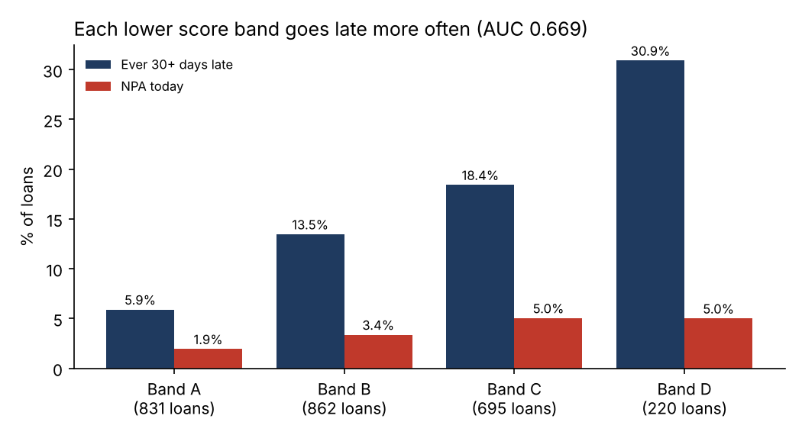
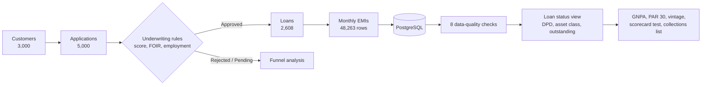
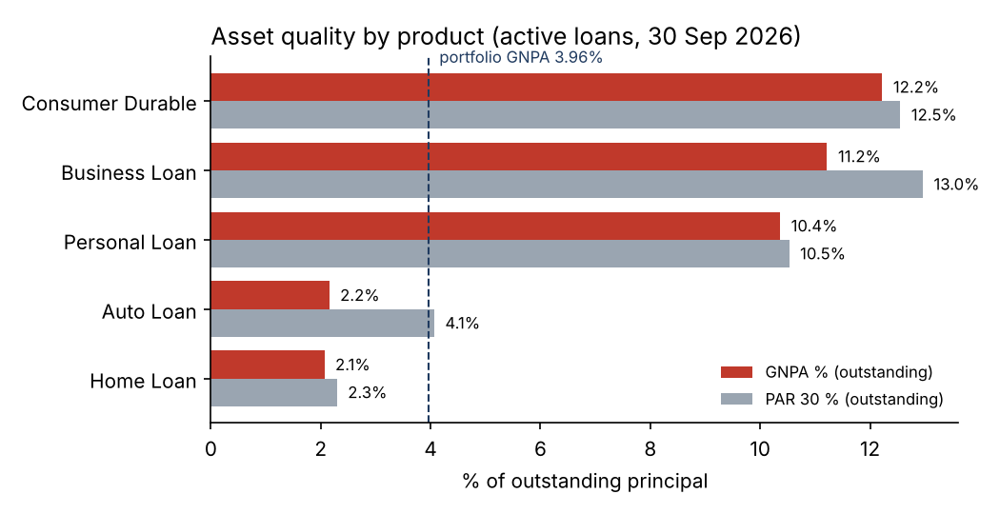
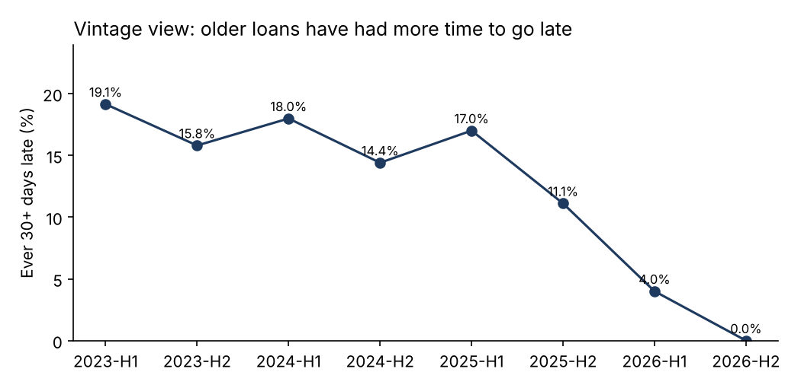

# CreditPulse: Loan Portfolio & Credit Risk Analytics

Credit risk analytics for a fictional Indian NBFC, from loan application to repayment: **5,000 applications, 2,608 loans and 48,263 EMI records**, analysed with **PostgreSQL** and **Python**. Underwriting rules decide every application, loans are classified the RBI way (**Standard / SMA-0 / SMA-1 / SMA-2 / NPA**) from current days past due, and an application scorecard is tested against how borrowers actually repaid.

> **All data is synthetic**, created by [`src/generate_data.py`](src/generate_data.py) (seeded, fully reproducible). Customers, branches and amounts are invented. Amounts are in INR. Business date: **30 Sep 2026**. A few data-quality problems were planted on purpose to test the checks.



## How it works



## Key findings (as of 30 Sep 2026)

| Area | Finding |
| --- | --- |
| Portfolio | 1,750 active loans, **₹110.98 crore** outstanding. |
| Asset quality | **GNPA 3.96%** and **PAR 30 4.59%** of outstanding principal; 91 loans are NPA. |
| Early warning | **14 loans** are in SMA-1/SMA-2 (31–90 days overdue). They are the collections priority list, before they turn NPA. |
| Underwriting | 52.6% of decided applications were approved. **High FOIR** (EMIs above 50% of income) causes 78.0% of rejections. |
| Products | Business (11.22%) and Personal loans (10.36%) have the highest GNPA on the active book; Home (2.07%) and Auto (2.15%) the lowest. |
| A trap in the numbers | Consumer Durable shows the worst active-book GNPA (12.22%), but only **3.2% of all Consumer Durable loans ever disbursed** are NPA. 492 of its 620 loans are short and already repaid, so the active book is mostly what is left. Business loans are the real worst product (6.9% of all disbursed). |
| Scorecard | Band D borrowers went 30+ days late **5.2x as often** as band A (30.9% vs 5.9%), and the rate rises at every band. AUC 0.669: useful, but weaker than a production scorecard (usually 0.70+). |
| Vintage | Loans from 2023–2025 H1 reached 14–19% "ever 30+ days late"; newer loans are lower mainly because they have had less time to go late. |
| Branches | Sitabuldi (7.85%) and Banjara Hills (7.34%) have the highest GNPA, but Sitabuldi's figure comes from only 7 NPA loans, so it needs watching, not conclusions. |

| GNPA and PAR 30 by product | Vintage curve |
| --- | --- |
|  |  |

## Rules used

All rules live in [`src/config.py`](src/config.py).

**Underwriting** (first rule that fails gives the reason):

| Rule | Reject if |
| --- | --- |
| Credit bureau score | below 650 |
| FOIR (all EMIs incl. the new one ÷ monthly income) | above 50% |
| Self-employed stability | fewer than 2 years in business |
| Documents | incomplete (about 4% of applications) |

Applications from the last 14 days are still **Pending**.

**Asset classification** from **current DPD** = days since the *oldest unpaid* EMI fell due:

| Current DPD | 0 | 1–30 | 31–60 | 61–90 | 90+ |
| --- | --- | --- | --- | --- | --- |
| Class | Standard | SMA-0 | SMA-1 | SMA-2 | NPA |

A loan that was once 45 days late but has caught up is **Standard** today. That is why classification uses current DPD, not the worst DPD ever.

**GNPA %** and **PAR 30 %** are measured on **outstanding principal** (from the amortisation schedule and the EMIs actually paid), not on the original disbursed amount.

**Application scorecard** (0–100, uses only what is known when the customer applies):

| Factor | Points |
| --- | --- |
| Bureau score | 800+: 40 · 750–799: 30 · 700–749: 20 · below 700: 10 |
| FOIR | ≤30%: 30 · ≤40%: 20 · above 40%: 10 |
| Employment | Salaried: 15 · Self-employed: 8 |
| Other loans | 0: 15 · 1: 10 · 2: 5 · 3+: 0 |

Bands: **A** 80+, **B** 65–79, **C** 50–64, **D** below 50. The weights are a judgement call, not trained on data; the validation above shows how well they work.

## Data-quality checks

[`sql/03_data_quality_checks.sql`](sql/03_data_quality_checks.sql):

| Check | Exceptions |
| --- | --- |
| Partial payment marked "Paid on Time" | 5 |
| Loan disbursed before its application date | 4 |
| Approved below the 650 minimum bureau score (policy exception) | 3 |
| Payment dated after the business date | 0 |
| Unpaid EMI with a payment recorded | 0 |
| Repayment booked to a different customer | 0 |
| EMI does not match the EMI formula | 0 |
| Approved application without a loan (or the reverse) | 0 |

The three non-zero checks match exactly the problems planted by the generator.

## Repository structure

| Folder | What is inside |
| --- | --- |
| [`data/`](data) | customers, applications, loans, repayments (CSV) |
| [`sql/`](sql) | `01_schema`, `02_load`, `03_data_quality_checks`, `04_analysis` (loan status view + 9 queries) |
| [`src/`](src) | `config.py` (all rules), `generate_data.py`, `portfolio.py` (loan status in Python), `analysis.py` |
| [`tests/`](tests) | 9 tests: classification boundaries, EMI formula, AUC, underwriting decisions, no future payments |
| [`outputs/`](outputs) | charts, `summary.json`, `sql_results.txt` |
| [`docs/`](docs) | data dictionary, Power BI build guide |

The loan status is calculated twice, in SQL (`v_loan_status`) and in Python (`portfolio.py`); both give the same GNPA, PAR 30 and NPA count.

## How to run

```bash
pip install -r requirements.txt
python src/generate_data.py      # recreate data/ (optional: files are already included)
python src/analysis.py           # charts + outputs/summary.json
python -m pytest -q              # 9 tests

createdb creditpulse
psql -d creditpulse -f sql/01_schema.sql -f sql/02_load.sql
psql -d creditpulse -f sql/03_data_quality_checks.sql -f sql/04_analysis.sql
```

In pgAdmin, use Import/Export Data for the CSV files instead of `02_load.sql` (steps are in that file).

## SQL techniques used

A view with a CTE for loan status, `COUNT(*) FILTER` and `SUM() FILTER` for conditional totals, `CASE` for asset classes, `POWER()` for the amortisation formula, `FULL JOIN` to find approvals without loans, window functions (`RANK`, `SUM() OVER`), and `NULLIF` against division by zero.

## Next step: Power BI dashboard

Planned, not yet built. Model, DAX measures and pages are in [`docs/POWER_BI_GUIDE.md`](docs/POWER_BI_GUIDE.md).

## Limitations

- Synthetic data: repayment behaviour was simulated from a hidden risk level linked to bureau score, FOIR, product and employment, so the analysis shows the method, not real market rates.
- The scorecard weights are set by judgement; a real lender would fit them on historical defaults (for example with logistic regression) and re-test them.
- Restructuring, write-offs and recoveries are not modelled.

---
Author: **Salil Gokhale** · [LinkedIn](https://www.linkedin.com/in/salil-gokhale-analytics)
